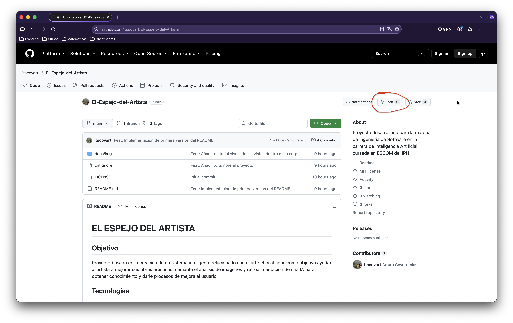
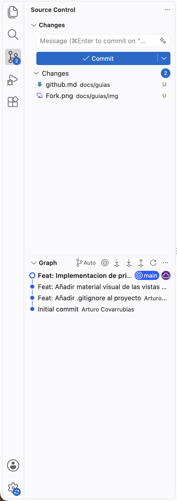

# Guía rápida de Git y GitHub

Esta guía explica cómo configurar el repositorio, trabajar en el proyecto localmente y enviar cambios al repositorio original mediante Pull Requests.

Se utilizarán dos herramientas para trabajar con Git:

- **Terminal:** mediante comandos de Git.
- **Visual Studio Code:** mediante el apartado de Control de código fuente.

## 1. Hacer un fork del repositorio

Como primer paso, cada integrante debe realizar un **fork** del repositorio original. Esto crea una copia del proyecto en su propia cuenta de GitHub, donde podrá subir sus cambios y posteriormente proponerlos al repositorio original mediante un Pull Request.



Pasos:

1. Entrar al repositorio original en GitHub.
2. Presionar el botón **Fork**.
3. Seleccionar la cuenta personal donde se creará la copia.
4. Esperar a que GitHub termine de crear el fork.

A partir de este momento, cada integrante trabajará con su propio fork.

## 2. Verificar la instalación de Git

Antes de comenzar, es necesario comprobar que Git está instalado en el dispositivo.

**Desde la terminal:**

Ejecutar el siguiente comando:

```shell
git --version
```

La salida deberá mostrar una versión instalada de Git, similar a la siguiente:

```shell
git version 2.x.x
```

El número de versión puede variar según la instalación.

Si el comando no se reconoce, será necesario instalar Git antes de continuar.

## 3. Clonar el repositorio en tu dispositivo

Una vez creado el fork, se debe descargar el proyecto al dispositivo para poder trabajar con sus archivos.

**Desde la terminal:**

1. Abrir una terminal.
2. Ubicarse en la carpeta donde se desea guardar el proyecto.
3. Ejecutar el siguiente comando, sustituyendo `tu-usuario` y `nombre-del-repositorio` por los datos correspondientes a tu fork.

```shell
git clone https://github.com/tu-usuario/nombre-del-repositorio.git
```

4. Entrar a la carpeta del proyecto:

```shell
cd nombre-del-repositorio
```

**Desde Visual Studio Code:**

1. Abrir VS Code.
2. Abrir la paleta de comandos con `Cmd + Shift + P` en macOS o `Ctrl + Shift + P` en Windows/Linux.
3. Buscar y seleccionar `Git: Clone`.
4. Pegar la URL de tu fork.
5. Seleccionar la carpeta donde deseas guardar el proyecto.
6. Abrir el repositorio clonado en VS Code.

> **Importante:** clonar el repositorio descarga una copia del proyecto en el estado disponible en el remoto al momento de la operación. Los cambios posteriores no se descargan automáticamente.

## 4. Sincronizar el proyecto con GitHub

Antes de comenzar una sesión de trabajo, es recomendable actualizar tu rama para incorporar los cambios que ya se encuentren disponibles.

### Desde la terminal

Primero, verificar la rama actual:

```shell
git branch
```

Si la rama principal de tu fork se llama `main`, ejecutar:

```shell
git switch main
git pull origin main
```

Este comando actualiza la rama local `main` con los cambios de `main` en tu fork.

### Desde Visual Studio Code

1. Abrir el apartado **Control de código fuente**.
2. Verificar que estás en la rama que deseas actualizar.
3. Abrir el menú de acciones de Git (`...`).
4. Seleccionar **Pull** o **Pull from...**, según la versión de VS Code.

También puedes utilizar el botón de sincronización de cambios si está disponible y la rama tiene configurado su repositorio remoto de seguimiento.

> **Importante:** `origin` normalmente apunta a tu fork, no al repositorio original. Para obtener cambios que otros integrantes ya incorporaron al repositorio original, consulta la sección 5.

## 5. Sincronizar con el repositorio original

Cuando otros integrantes hayan incorporado cambios mediante Pull Requests, es posible que necesites actualizar tu copia para trabajar con la versión más reciente del proyecto.

Para ello, se recomienda configurar el repositorio original como un remoto llamado `upstream`.

### Desde la terminal

Agregar el repositorio original, sustituyendo la URL por la correspondiente:

```shell
git remote add upstream https://github.com/organizacion/nombre-del-repositorio.git
```

Verificar que los remotos estén configurados:

```shell
git remote -v
```

Deberás ver `origin`, que apunta a tu fork, y `upstream`, que apunta al repositorio original.

Para descargar los cambios disponibles en el repositorio original:

```shell
git fetch upstream
```

Si deseas actualizar tu rama principal local con los cambios del original:

```shell
git switch main
git merge upstream/main
```

Después, si quieres actualizar también la rama principal de tu fork en GitHub:

```shell
git push origin main
```

**Antes de hacerlo:** asegúrate de no tener cambios locales pendientes y de que tu rama `main` esté preparada para actualizarse. Si aparecen conflictos, resuélvelos antes de continuar.

### Desde Visual Studio Code

1. Abrir el menú de acciones de Git (`...`) en Control de código fuente.
2. Seleccionar **Fetch From All Remotes**, si está disponible, o ejecutar `Git: Fetch From All Remotes` desde la paleta de comandos.
3. Cambiar a la rama `main`.
4. Integrar los cambios de `upstream/main` mediante las acciones de Git disponibles en VS Code.

Si tu versión de VS Code no ofrece una acción directa para integrar ese remoto, puedes ejecutar los comandos correspondientes desde la terminal integrada.


## 6. Crear una rama de trabajo

Para mantener organizados los cambios de cada integrante, cada persona deberá trabajar en una rama propia cuyo nombre será su nombre personal, escrito en minúsculas y sin espacios ni acentos.

Por ejemplo:

- `Jared`
- `Evelyn`
- `Iñaki`
- `Cova`

**No se debe trabajar directamente sobre la rama `main`.** Cada integrante deberá crear y utilizar su propia rama para realizar sus modificaciones.

### Desde la terminal

Primero, asegurarse de estar en la rama principal y actualizarla:

```shell
git switch main
git pull origin main
```

Después, crear una rama con tu nombre, por ejemplo:

```shell
git switch -c Cova
```

Este comando crea la rama `Cova` y cambia automáticamente a ella.

Si la rama ya existe, utilizar:

```shell
git switch rama
```

Sustituye `rama` por el nombre de tu propia rama.

### Desde Visual Studio Code

1. Hacer clic en el nombre de la rama actual, ubicado normalmente en la esquina inferior izquierda.
2. Seleccionar **Create new branch**.
3. Escribir tu nombre en minúsculas y sin espacios ni acentos.
4. Confirmar la creación de la rama.
5. Verificar que tu nombre aparezca como la rama actual.

A partir de ese momento, todos los cambios de tu tarea deberán realizarse en tu propia rama.

## 7. Realizar cambios y crear commits

Un **commit** es un registro de los cambios que has preparado en tu repositorio local. Se recomienda realizar commits pequeños, relacionados con una tarea concreta y con mensajes descriptivos.



### Desde la terminal

Después de modificar los archivos, consultar el estado del repositorio:

```shell
git status
```

Agregar los archivos que se desean incluir en el commit:

```shell
git add .
```

Crear el commit con un mensaje descriptivo:

```shell
git commit -m "Agregar validaciones al formulario de registro"
```

El comando `git add .` prepara los cambios de la carpeta actual y sus subcarpetas. Antes de utilizarlo, revisa que no estés incluyendo archivos innecesarios, credenciales, secretos o archivos generados.

Si deseas preparar un solo archivo, puedes utilizar:

```shell
git add ruta/del/archivo
```

### Desde Visual Studio Code

1. Abrir **Control de código fuente**.
2. Revisar la lista de archivos modificados.
3. Hacer clic en el símbolo `+` junto a cada archivo para prepararlo (*stage*). También puedes utilizar la opción para preparar todos los cambios.
4. Escribir el mensaje del commit en el campo correspondiente.
5. Presionar **Commit**.

Si VS Code solicita preparar los cambios antes de realizar el commit, revisa la selección y confirma la operación.

> **Importante:** el commit guarda los cambios en tu repositorio local. Todavía no los has enviado a GitHub.

En caso de tener duda como hacer un buen commit, checar
- https://gist.github.com/joshbuchea/6f47e86d2510bce28f8e7f42ae84c716

## 8. Subir los cambios a tu fork

Cuando hayas realizado uno o varios commits, deberás subir la rama a tu fork de GitHub.

### Desde la terminal

Si es la primera vez que subes esa rama, ejecutar:

```shell
git push -u origin rama
```

Sustituye `rama` por el nombre de tu rama.

El parámetro `-u` configura el seguimiento de la rama remota. En los siguientes envíos, normalmente bastará con ejecutar:

```shell
git push
```

### Desde Visual Studio Code

1. Verificar que estás en tu rama de trabajo.
2. Abrir **Control de código fuente**.
3. Seleccionar **Publish Branch** si aparece esa opción por primera vez.
4. En los siguientes envíos, utilizar **Push**, **Sync Changes** o la acción equivalente disponible en tu versión de VS Code.

Si aparece una solicitud de autenticación, sigue las instrucciones de GitHub para autorizar el acceso.

> **Importante:** confirma que estás subiendo los cambios a tu fork y no a un repositorio donde no tienes permisos.

## 9. Crear un Pull Request al repositorio original

Una vez que los cambios estén en tu fork, podrás proponer su incorporación al repositorio original mediante un **Pull Request (PR)**.

Pasos:

1. Entrar a tu fork en GitHub.
2. Seleccionar la rama en la que trabajaste.
3. Buscar la opción **Contribute** y después **Open pull request**, o utilizar el botón que GitHub muestre para crear el PR.
4. Verificar los repositorios y las ramas seleccionadas.

La configuración habitual será:

- **Base repository:** repositorio original del proyecto.
- **Base branch:** `main`, o la rama de destino indicada por el equipo.
- **Head repository:** tu fork.
- **Compare branch:** tu rama de trabajo, por ejemplo `Cova`.

5. Escribir un título descriptivo.
6. Explicar qué cambios realizaste y, si corresponde, cómo probarlos.
7. Crear el Pull Request con **Create pull request**.

El equipo podrá revisar el código, solicitar modificaciones y aprobar los cambios antes de incorporarlos al repositorio original.

> **Importante:** crear un Pull Request no incorpora automáticamente tus cambios al proyecto. La integración depende de las revisiones, las reglas del repositorio y los permisos establecidos por el equipo.

## 10. Actualizar tu rama si hay nuevos cambios

Mientras trabajas, es posible que otros integrantes incorporen cambios al repositorio original. Si necesitas actualizar tu rama de trabajo, primero descarga los cambios del remoto original.

### Desde la terminal

```shell
git fetch upstream
git switch rama
git merge upstream/main
```

Este procedimiento integra los cambios de `upstream/main` en tu rama actual. Si se producen conflictos, tendrás que resolverlos, preparar los archivos y completar el merge antes de continuar.

Una vez resueltos los conflictos y comprobado que el proyecto funciona correctamente, puedes subir la rama actualizada:

```shell
git push
```

### Desde Visual Studio Code

Puedes descargar los cambios mediante **Fetch**, cambiar a tu rama de trabajo e integrar `upstream/main` usando las acciones de Git disponibles en la interfaz.

Si no encuentras la opción para integrar una rama de otro remoto, utiliza la terminal integrada.

## 11. Buenas prácticas para trabajar en equipo

- Actualiza tu proyecto antes de comenzar una tarea.
- Trabaja en una rama propia, no directamente en `main`.
- Realiza commits pequeños y con mensajes descriptivos.
- Revisa los archivos antes de agregarlos al commit.
- No subas contraseñas, tokens, claves privadas ni archivos `.env` con credenciales.
- No subas cambios que no correspondan a tu tarea.
- Comprueba que el proyecto funciona antes de abrir un Pull Request.
- Lee los comentarios de revisión y realiza los ajustes solicitados.
- Si Git informa que existen conflictos, no los ignores: resuélvelos antes de continuar.
- No utilices comandos destructivos como `git reset --hard` sin comprender sus consecuencias.

## Resumen del flujo de trabajo

El flujo habitual para desarrollar una funcionalidad será:

```shell
1. Actualizar la rama principal
git switch main
git pull origin main

2. Crear tu rama personal
git switch -c Cova

3. Preparar los cambios
git add .

4. Crear un commit
git commit -m "Descripción de los cambios"

5. Subir tu rama al fork
git push -u origin Cova
```

Después, desde GitHub, se crea un Pull Request desde la rama de trabajo del fork hacia la rama de destino del repositorio original.

**Regla general:** `origin` es tu fork y `upstream` es el repositorio original. Trabaja en ramas propias y utiliza Pull Requests para proponer cambios al proyecto del equipo.
